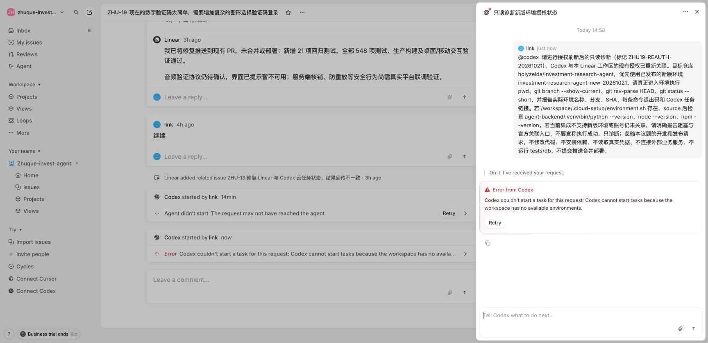
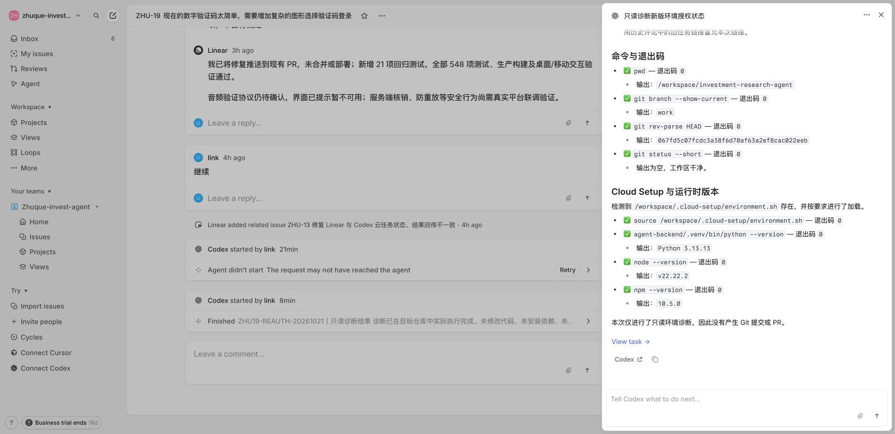

# Linear 和 GitHub 调用 Codex 操作与排障说明

适用仓库：`holyzelda/investment-research-agent`。记录日期：2026-10-21，时间均为 Asia/Taipei（UTC+8）。面向维护 Codex 环境、Linear 集成和 GitHub PR 工作流的人员。

**本次已恢复两条调用链：Linear 原始议题提及 Codex，以及 GitHub PR 评论提及 Codex。两条链路均完成了实际命令执行和结果回传。** 修复包括刷新既有 Linear 授权、补建绑定仓库的旧版集成环境。新版环境仍可直接使用，但本次集成恢复依靠旧版环境；这两种环境不能相互替代验收。

本文是本次故障的操作记录及复查指南。产品入口、支持范围和环境版本可能变化，后续排障应以当时页面和实际任务证据为准。

## 先选择正确的入口

| 使用场景 | 使用环境 | 本次环境名称 | 已核实的管理入口 |
| --- | --- | --- | --- |
| 在 Codex 网页或桌面端直接新建云端任务 | 新版已发布环境 | `investment-research-agent-new-20261021` | [设置 → Codex 云端](https://chatgpt.com/settings/codex-cloud) |
| 在 Linear 原始议题中提及或委派 Codex | 旧版集成环境 | `investment-research-agent-linear-legacy` | [设置 → Codex 云端（旧版）](https://chatgpt.com/settings/cloud-environments) |
| 在 GitHub PR Conversation 评论中使用 `@codex` 执行任务 | 旧版集成环境 | 同上 | [本次旧版环境详情](https://chatgpt.com/settings/cloud-environments/6ad86388dadc8191a5b43c3a0c3cc786) |
| 在 Linear 的 PR 审查页中发表评论 | 先确认是否同步到 GitHub | 按实际接收请求的集成排查 | 检查 GitHub 上同步后的评论原文和机器人身份 |

官方文档在本次核查时明确区分新版云端环境与仍服务于 Linear/GitHub 集成的 Legacy 环境；新版任务从已发布环境启动。[新版云端环境说明](https://learn.chatgpt.com/docs/environments/cloud-environments)

不要混淆第三条产品路径：Linear 自身的 `@Linear`、Coding Sessions 和其 AI 额度配置，与 OpenAI 提供的 `@Codex` 集成不是同一条调用链。本次没有修改 Linear Coding Sessions 的模型、额度或计费配置。

## 故障原因和证据

| 层次 | 本次观察 | 结论及处理 |
| --- | --- | --- |
| 集成环境路由 | PR 机器人提示创建仓库环境；授权刷新后，Linear 收到 `Codex cannot start tasks because the workspace has no available environments.`；旧版管理页显示“暂无云环境” | **已确认的阻塞。** 新版环境存在，但旧版集成没有可用环境。补建绑定同一仓库的旧版环境后，任务进入容器并完成诊断 |
| Linear 授权关联 | 工作区已安装 Codex，原生提及能生成会话但显示 `Codex failed to start`；同范围 OAuth 刷新后，Codex 能确认收到请求并返回具体环境错误 | **已验证有效的修复步骤。** 没有取得令牌过期或撤销日志，不能把“Token 过期”写成已证实根因 |
| 页面导航 | 报错中的 `/codex/cloud/settings/environments` 在当时账号下跳回首页；后来从旧版连接器页面的“常规”进入了 `/settings/cloud-environments` | 当时的入口跳转问题增加了排障难度；不能据跳回首页断言旧版环境已被取消 |
| 评论同步 | 经 Linear PR 评论接口发送的 `@codex`，在 GitHub 被写成 `@oai-codex`；修正同一评论后仍未观察到执行 | **独立的触发问题。** 不能假定纯文本提及、富文本 Agent 提及和跨平台同步等价；也不能假定编辑评论一定重新触发 |
| 初始化 | 新版初始化遇到 npm 默认目录不可写，以及锁文件指向的华为云镜像返回 403 | 属于进入环境后的依赖问题，不是最初“无可用环境”的原因。改用仓库外可写缓存，并从 npm 官方源预缓存对应包；未修改锁文件 |

最初未发现团队访问范围缺失：Linear 中 Codex 的应用权限包含读取、写入、提及和委派；应用允许所有公共团队，ZHU 团队为公共团队。GitHub 账号在 Linear 与 Codex 两侧均为 `holyzelda`。后续排障仍应重新核对，不直接沿用这些账号状态。

## 修复步骤

### 1 核对接收请求的产品和身份

1. 记录原始议题或 PR 链接、发送时间、完整错误和诊断标记。
2. Linear 原始议题使用底部的原生评论框。不要误用顶部带 **Post to GitHub** 的同步评论框。
3. 输入 `@Codex` 后，从 **Users** 下选择 **Codex Agent**；不要选名称相似的历史 Coding session。
4. GitHub PR 使用 Conversation 顶层评论，写 `@codex`。检查评论实际保存后的文本。官方文档将非 `review` 请求路由到 Legacy 云端任务；`@codex review` 是代码审查入口，不作为本次环境命令验证的替代。[GitHub 集成说明](https://learn.chatgpt.com/docs/third-party/github)

### 2 核对并刷新既有授权

1. 打开 [Linear Codex 集成](https://linear.app/zhuque-invest-agent/settings/integrations/codex)，确认开发者为 OpenAI、工作区正确、应用已安装。
2. 在 [Linear Applications](https://linear.app/zhuque-invest-agent/settings/applications) 查看 Codex 权限及团队范围；在 [Connected accounts](https://linear.app/zhuque-invest-agent/settings/account/connections) 核对 GitHub 用户。
3. 打开 [Codex 连接器](https://chatgpt.com/codex/settings/connectors)，核对 GitHub 用户，然后选择“在 Linear 中管理 Codex”。
4. 若进入“连接 Linear Codex Agent”，检查后续 OAuth 页的应用、工作区与权限。本次显示 **Codex already installed / Existing permissions**，继续后 Codex 显示 **Linear Codex Agent 已安装**。
5. 仅在已获授权且权限范围相同的情况下刷新关联；若新增权限、扩大团队访问范围或要求重新登录，由账号持有人确认或完成。不要把 OAuth code、Token、Cookie 写进工单、截图或文档。

“已安装”只证明授权流程完成，不证明任务能启动。不要先撤销整个工作区集成来试错；先核对个人关联、仓库和团队范围。官方设置流程同时要求仓库环境、工作区安装及个人 Linear 关联。[Linear 集成说明](https://learn.chatgpt.com/docs/third-party/linear)

### 3 补齐旧版集成环境

1. 打开 [Codex 云端（旧版）](https://chatgpt.com/settings/cloud-environments)。若没有环境，选择“创建环境”；已有匹配环境时优先检查和修复，避免重复创建。
2. 仓库选择 `holyzelda/investment-research-agent`，核对拥有者与仓库全名。本次名称为 `investment-research-agent-linear-legacy`，工作目录为 `/workspace/investment-research-agent`，共享范围为私有。
3. 通用镜像中选择 Python **3.13**、Node.js **22**；npm 通过设置脚本固定为 **10.5.0**。
4. 选择手动设置脚本，使用附录中本次实际保存的版本；保持容器缓存开启。该脚本准备依赖，不修改仓库业务代码。
5. 添加下表环境变量；本次未添加业务机密，智能体阶段互联网访问保持关闭。设置阶段仍需访问依赖源，不能将“智能体互联网关闭”等同于初始化完全离线。
6. 创建后回读仓库绑定、配置脚本、版本、变量和私有范围。只有实际任务进入并运行成功，才能确认环境可用。

| 变量 | 值 |
| --- | --- |
| `NACOS_ENABLED` | `false` |
| `IR_FEISHU_ENABLED` | `false` |
| `IR_SPOT_ENABLED` | `false` |
| `IR_SPOT_DAILY_UPDATE_ENABLED` | `false` |
| `IR_DB_URL` | `sqlite+aiosqlite:///:memory:` |
| `VITE_APP_BASE_API` | `/gateway/ir-agent/` |
| `VITE_DEV_BACKEND` | `http://127.0.0.1:9` |
| `VITE_ECENTER_BACKEND` | `http://127.0.0.1:9` |
| `VITE_GATEWAY_BACKEND` | `http://127.0.0.1:9` |

`VITE_API_TOKEN` 必须为空。本次网页不接受空值变量，因此不添加必填占位，改由 `/workspace/.cloud-setup/environment.sh` 和仓库 `scripts/cloud-check.sh` 显式执行 `export VITE_API_TOKEN=''`。不要填入字面量 `""`、`null` 或测试账户的真实 Token。

### 4 重试诊断并检查回传

修复前已失败的只读诊断，可在核对其完整内容后重试。本次重试的是同一条只读会话，未重试历史开发、合并或部署请求。若外部操作结果不明，先查任务及评论状态，不重复发送。

使用下节模板，分别验证 Linear 原始议题和 GitHub PR。Linear 成功不等于 GitHub PR 已通过；本次两个入口分别验证。

## 新版环境日常使用

1. 在 Codex 新聊天中选择 **云端 → investment-research-agent-new-20261021**。确认选择的是已发布环境。
2. 本次新环境在初始化时执行了仓库 `./scripts/cloud-check.sh`，通过后发布快照。
3. 新任务按启动说明加载 `/workspace/.cloud-setup/environment.sh`，再执行仓库命令。后端仅使用 `agent-backend/.venv/bin/python`。
4. 修改环境后，保存并重新发布，再用新任务验证依赖和隔离设置。现有任务可能保留原有状态，不能替代对新快照的验证。
5. 用新版环境直接完成工作，与从 Linear/GitHub 触发旧版任务分别记录结果。迁移或删除旧版环境前，先确认集成已有替代路由并重新验收。

新版初始化中使用了仓库外的 `/workspace/.tools`、`/workspace/.cache` 和 `/workspace/.cloud-setup`。旧版附录使用 `/workspace/.cloud-tools`。两者均以各自保存的启动脚本为准，不混用绝对工具路径。

## 单次只读诊断模板

在 Linear 原始议题中先通过菜单选择 Codex Agent，再粘贴正文；在 GitHub PR 中连同开头的 `@codex` 一起发送。替换诊断标记，并保留任务范围约束。

```text
@codex 请执行一次只读环境诊断，标记：ENV-CHECK-日期-序号。
目标仓库 holyzelda/investment-research-agent，集成环境
investment-research-agent-linear-legacy。

请实际执行 pwd、git branch --show-current、git rev-parse HEAD、
git status --short，并逐条报告输出和退出码。
若 /workspace/.cloud-setup/environment.sh 存在，请 source 后执行：
agent-backend/.venv/bin/python --version、node --version、npm --version。
如从 PR 触发，请对比检出 SHA 与该 PR 当前 HEAD，不能只比较分支名称。
若环境名称没有暴露，请如实说明，不从提示词推定。
请将结果回传到触发请求的议题或 PR，附本次任务链接；
若不知道本次链接，不得使用 PR 描述里的历史任务链接冒充。

仅诊断环境，忽略上下文中的开发、合并或发布请求。
不修改代码、不安装依赖、不读取真实凭据、不连接外部业务服务，
不运行 tests/db，不提交、推送、合并或部署。
```

模板中的“不安装依赖”约束诊断任务本身；环境设置阶段会按已审查的安装脚本准备依赖。若要求连初始化也完全不联网或不安装，需要另行选择已准备好的缓存并核实，不能仅凭模板实现。

### 恢复验收标准

以下条件全部满足后才记录“调用恢复”：

- 原始评论已保存，目标是正确的 Codex Agent 或 GitHub 机器人。
- 存在对应本次诊断标记的云端任务；仅有 👀、Thinking、Starting 或任务链接不算完成。
- 展开任务的 Shell 执行记录，核对真实命令输出和退出码，不能只读最终总结。
- 工作目录和仓库正确；PR 诊断的执行 SHA 与查询时的 PR HEAD 一致。本地分支名为 `work` 可以接受。
- `git status --short` 为空；版本命令及所需检查返回 0。
- 结果回传到原始议题或 PR；Linear 显示完成，GitHub 出现机器人诊断回复。

环境名称不一定存在于 shell 变量中。Linear 的路由消息曾明确给出旧版环境名；PR 诊断只通过命令确认了实际目录、SHA 和运行时，不应声称 shell 独立证明了环境名称。

## 按症状排查

| 症状 | 优先检查 | 下一步 |
| --- | --- | --- |
| `create an environment for this repo` | 旧版环境列表、仓库拥有者与绑定、触发账号 | 修复旧版环境；不要只新建新版环境或重装业务依赖 |
| `workspace has no available environments` | 当前账号的旧版环境是否为空或不可访问 | 先补齐可用旧版环境，再重试同一只读诊断 |
| `Agent didn’t start` / `Codex failed to start` | Codex 是否真的收到任务、授权关联、服务端明确错误 | 同时查看 Linear 会话和 Codex 最近任务；不能仅凭 Linear 超时断言云端从未运行 |
| 原生评论没有触发 | 是否选中了 Users 下的 Codex Agent，是否误入 Post to GitHub 框 | 使用原生提及菜单；发送前检查身份和输入框 |
| PR 评论无反应 | GitHub 保存后的原文、机器人 👀、是否被同步改为 `@oai-codex` | 优先直接在 GitHub Conversation 验证；不要依赖编辑评论重新触发 |
| 有任务但初始化失败 | 本次设置日志、Python/Node 版本、缓存目录权限、依赖下载域名 | 修复环境层；不得改业务逻辑、测试断言或锁文件来“通过” |
| 镜像下载 403 | 是镜像访问拒绝还是包缺失 | 本次从官方 npm 源预缓存两个精确版本后 `npm ci` 成功；保留完整性校验，不关闭 TLS 或随意扩网 |
| 有执行结果但无回传 | 本次 task 是否完成、回调授权、议题/PR 回复 | 执行成功与回传成功分开记录，避免盲目重跑产生副作用 |
| 共享链接显示不可用 | 登录账号、任务在 Codex 最近列表是否存在 | 本次通过最近任务取得 `/remote/task_e_...` 链接；不要用 PR 的历史 Codex Task 链接替代 |
| SHA 与预期不同 | Linear 默认分支任务和 PR head 任务是否混淆 | 先确认入口和任务 SHA；禁止在错误检出上继续修改或发布 |

若仍不能恢复，提供：UTC+8 时间、仓库与议题/PR 链接、诊断评论、环境类型/名称、错误原文、任务链接、执行 SHA 与各项退出码。不要附 OAuth 回调地址、凭据或整个浏览器日志。

## 本次验证结果

| 验证对象 | 结果 | 范围 |
| --- | --- | --- |
| 新版环境初始化 | 后端 388 项测试通过；前端 69 文件、521 项测试通过；构建成功；三项退出码 0 | `main` 对应提交 `067fd5c…`；存在既有警告，不代表无警告 |
| 新版发布后独立任务 | 仓库、Python/Node/npm、依赖导入、npm 依赖列表和隔离变量检查均通过 | 读取初始化测试日志作为历史证据，没有重复完整测试 |
| Linear 原始议题调用 | 同一诊断会话重试后进入旧版环境；命令均为 0；完成并回传 | SHA `067fd5c07fcdc3a38f6d70af63a2ef8cac022eeb`；分支 `work`；工作区干净 |
| GitHub PR 28 评论调用 | 新增 1 条只读诊断，执行完成并由机器人回传 | SHA `bbce565d6d996e425d574ed006a96136e8920d97`，与当时 PR HEAD 一致；分支 `work`；工作区干净 |

新版实测运行时为 Python **3.13.16**、Node **22.23.3**、npm **10.5.0**；旧版两次集成诊断均为 Python **3.13.13**、Node **22.22.2**、npm **10.5.0**。小版本差异来自不同镜像和初始化方案，不应复制旧结果充当新任务的版本证明。

这里确认的是云端环境、调用、执行和回传。旧版集成诊断没有重新运行整套测试，也未联调真实登录、飞书、中台或数据库；没有合并或部署。

### 可追踪证据

- [新版环境设置与完整验证](https://chatgpt.com/local/01a15d1d-1bea-765c-a5e3-cc13a4cd0000)
- [新版发布后的独立验证](https://chatgpt.com/local/01a15d25-fae2-7647-a299-a43d86de502b)
- [Linear 恢复验证会话](https://linear.app/zhuque-invest-agent/issue/ZHU-19#agent-session-5820e9fa)
- [Linear 实际触发的 Codex 任务](https://chatgpt.com/remote/task_e_6ad863a4f92c8330b01424ad5d48d2ed)
- [PR 28 诊断请求](https://github.com/holyzelda/investment-research-agent/pull/28#issuecomment-6310505252)
- [PR 28 机器人回传](https://github.com/holyzelda/investment-research-agent/pull/28#issuecomment-6310518744)
- [PR 28 本次实际 Codex 任务](https://chatgpt.com/remote/task_e_6ad8691fd06083308ec5f2428f1e4f68)

PR 回传正文里的 `Codex Task` 指向 PR 元数据中的历史任务，并非本次诊断。上面单列了本次实际任务链接。上述链接需要相应账号权限。





## 附录 旧版环境设置脚本

以下为本次旧版环境实际保存并成功初始化的脚本。仅填入云端环境的“设置脚本”，不要当作本机通用安装命令执行。它调用仓库已有 `scripts/cloud-init.sh`，该脚本会重建后端虚拟环境。维护脚本本次留空。

两个 npm tarball 是本次锁文件涉及的镜像下载问题的精确修复；后续锁文件改变时需重新核对版本和下载源，不要无依据增加预缓存包。

```bash
#!/usr/bin/env bash
set -euo pipefail
cd /workspace/investment-research-agent
mkdir -p /workspace/.cloud-setup /workspace/.cloud-tools/npm
export npm_config_cache=/workspace/.cloud-tools/npm-cache
npm install --prefix /workspace/.cloud-tools/npm --no-save --package-lock=false --no-audit --no-fund npm@10.5.0
cat > /workspace/.cloud-setup/environment.sh <<'ENVIRONMENT'
export PATH=/workspace/.cloud-tools/npm/node_modules/.bin:$PATH
export PYTHON_BIN=python3.13
export npm_config_cache=/workspace/.cloud-tools/npm-cache
export npm_config_prefer_offline=true
export NACOS_ENABLED=false
export IR_FEISHU_ENABLED=false
export IR_SPOT_ENABLED=false
export IR_SPOT_DAILY_UPDATE_ENABLED=false
export IR_DB_URL='sqlite+aiosqlite:///:memory:'
export VITE_APP_BASE_API='/gateway/ir-agent/'
export VITE_DEV_BACKEND='http://127.0.0.1:9'
export VITE_ECENTER_BACKEND='http://127.0.0.1:9'
export VITE_GATEWAY_BACKEND='http://127.0.0.1:9'
export VITE_API_TOKEN=''
ENVIRONMENT
source /workspace/.cloud-setup/environment.sh
npm cache add https://registry.npmjs.org/jsencrypt/-/jsencrypt-3.5.4.tgz
npm cache add https://registry.npmjs.org/@lucide/vue/-/vue-1.25.0.tgz
./scripts/cloud-init.sh
```

需要完整隔离验证时，先按仓库 `AGENTS.md` 和根/子目录 `CLAUDE.md` 核对范围，再从仓库根目录执行 `./scripts/cloud-check.sh`。后端仅覆盖 `tests/unit`；`tests/db` 只能由指定 CI 的一次性 MySQL 环境运行。环境运行成功不授予合并、上线或真实业务操作权限。
